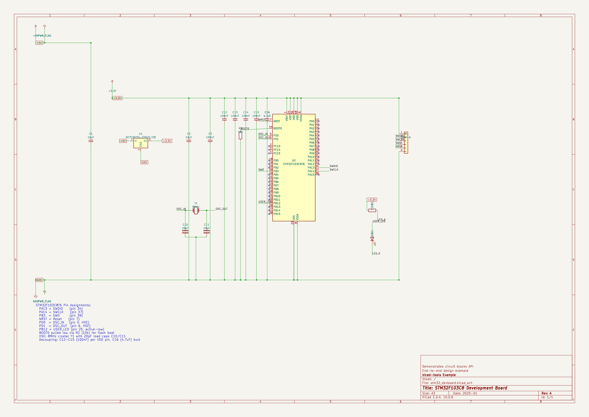
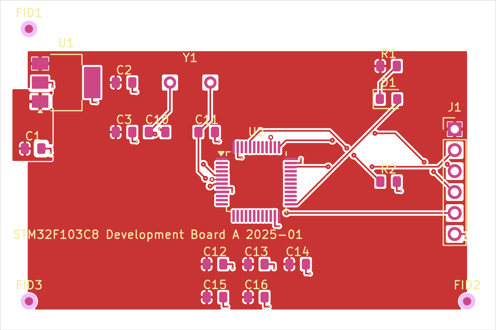
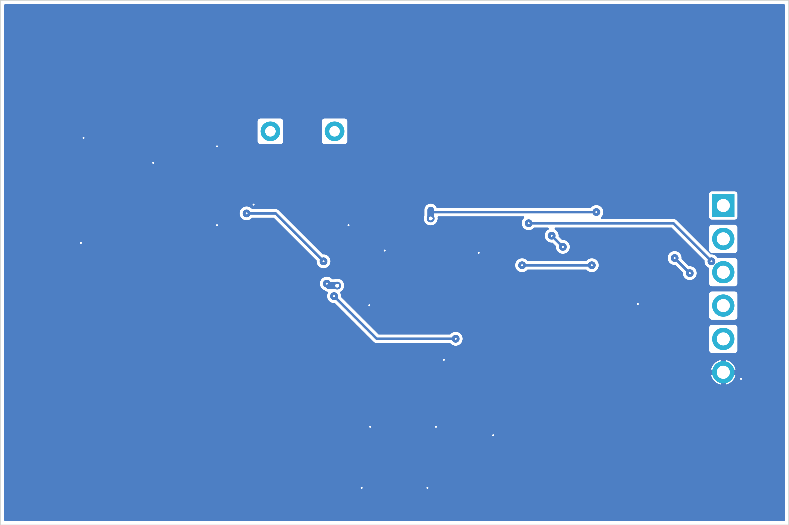
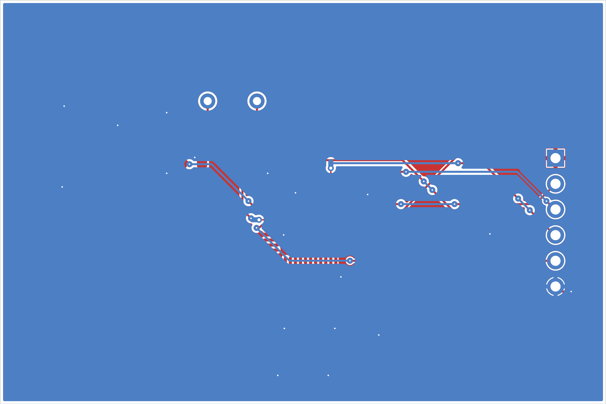
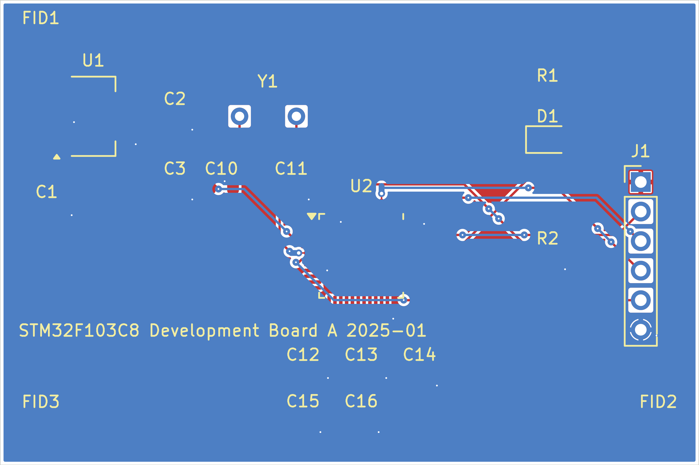
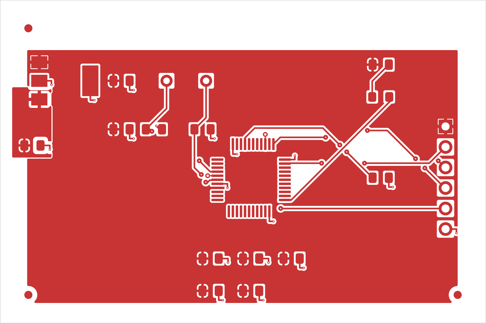
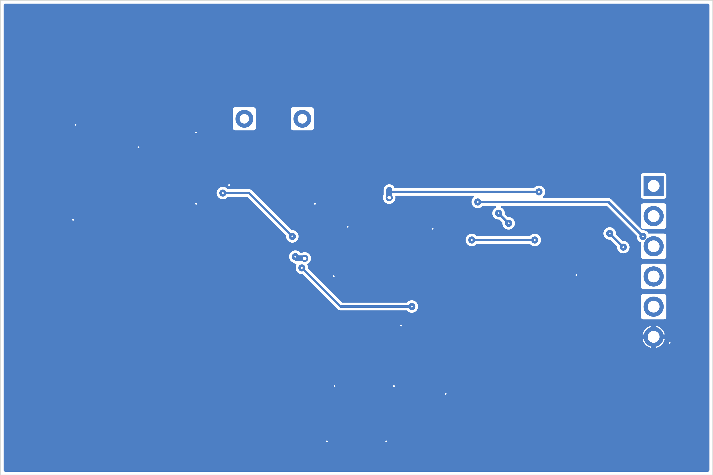

## Board Summary

| Property | Value |
|----------|-------|
| Layers | 2 copper (F.Cu, B.Cu) |
| Footprints | 20 (18 SMD, 2 THT, 0 other) |
| Nets | 12 |
| Traces | 93 segments |
| Vias | 34 |
| Board Size | 60.0 x 40.0 mm |

## Design Overview

### Theory of Operation

STM32F103C8 Development Board

End-to-end design example

Demonstrates circuit blocks API

### Power Architecture

**Power Rails**: +3.3V, +5V, GND

| Regulator | Device |
|-----------|--------|
| U1 | MCP1825S-3302E/DB |

## Assembly Notes

1 fine-pitch component; 1 polarized component

- **Fine-pitch components**: 1 (U2)
- **Polarized components**: 1 -- check orientation markings

## ERC Status

| Metric | Count |
|--------|-------|
| Errors | 0 |
| Warnings | 0 |

**Status**: PASS

\newpage

## Schematic Overview

### Schematic: stm32_devboard

\newpage

## PCB Layout

### Copper

### Assembly

\newpage

## Copper Layers

### F.Cu

### B.Cu

\newpage

## Bill of Materials

| Value | Package | Qty | References | MPN | LCSC |
|-------|---------|-----|------------|-----|------|
| 100nF | C_0805_2012Metric | 5 | C3, C12, C13, C14, C15 |  |  |
| 10uF | C_0805_2012Metric | 2 | C1, C2 |  |  |
| 20pF | C_0805_2012Metric | 2 | C10, C11 |  |  |
| 4.7uF | C_0805_2012Metric | 1 | C16 |  |  |
| LED | LED_0805_2012Metric | 1 | D1 |  |  |
| SWD-6 | PinHeader_1x06_P2.54mm_Vertical | 1 | J1 |  |  |
| 10k | R_0805_2012Metric | 1 | R2 |  |  |
| 330R | R_0805_2012Metric | 1 | R1 |  |  |
| MCP1825S-3302E/DB | SOT-223-3_TabPin2 | 1 | U1 | MCP1825S-3302E/DB | C148031 |
| STM32F103C8T6 | LQFP-48_7x7mm_P0.5mm | 1 | U2 |  |  |
| 8MHz | Crystal_HC49-4H_Vertical | 1 | Y1 |  |  |

\newpage

## DRC Status (`--mfr jlcpcb-tier1` rules)

| Metric | Count |
|--------|-------|
| Errors | 68 |
| Errors: kct (`--mfr jlcpcb-tier1` rules) | 68 |
| Errors: kicad-cli (geometric) | 0 |
| Warnings | 8 |
| Blocking | 68 |

**Status**: FAIL

### Violations by Type

| Violation Type | Count |
|----------------|-------|
| dimension_via_drill | 32 |
| dimension_via_diameter | 18 |
| dimension_annular_ring | 18 |
| pour_slot | 8 |

\newpage

## Manufacturing Readiness

**Verdict**: NOT_READY

### Action Items

- **[CRITICAL]** Fix 68 blocking DRC violations (dimension_via_drill (32), dimension_via_diameter (18), dimension_annular_ring (18))
- **[CRITICAL]** Increase min via drill: 0.150mm < 0.300mm required
- **[OPTIONAL]** Refill zones to verify 3 zone-connected nets, then re-run kct audit
- **[OPTIONAL]** Review 8 DRC warnings

\newpage

## Routing Status

| Metric | Value |
|--------|-------|
| Signal Net Completion | 100.0% (9/9) |
| Overall Completion | 100.0% |
| Complete Nets | 12 / 12 |
| Zone-Connected Nets | 3 |
| Incomplete Nets | 0 |
| Unconnected Pads | 0 |

### Zone-Connected Nets

- +3.3V
- +5V
- GND

## Cost Estimate

| Metric | Per Board (estimated) |
|--------|-------|
| PCB Fabrication | ~0.88 USD |
| Components (estimated) | ~1.4 USD |
| Assembly (estimated) | ~2.04 USD |
| **Total (estimated)** | **~4.31 USD** |
| Batch Quantity | 5 |
| Batch Total (estimated) | ~21.55 USD |

