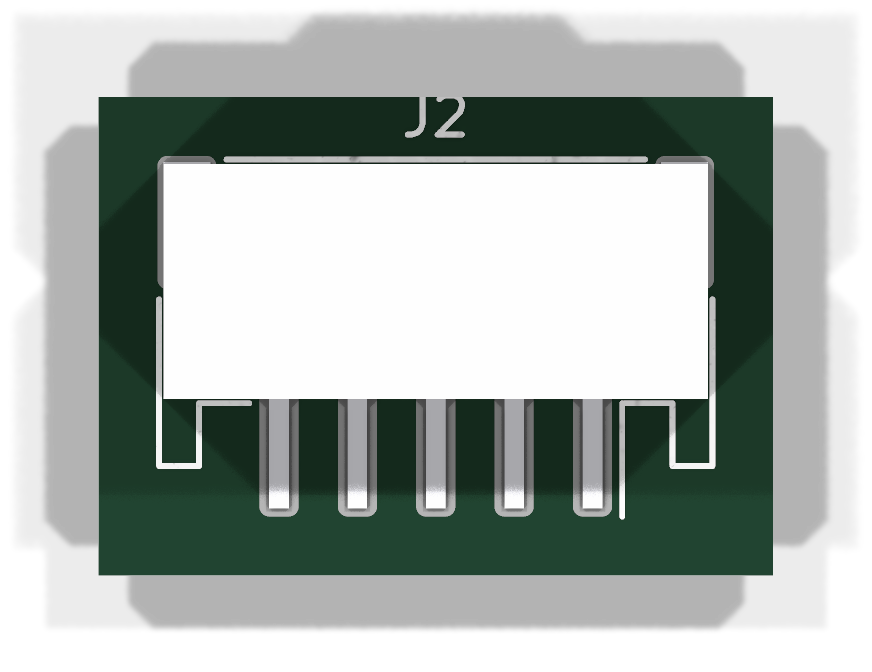
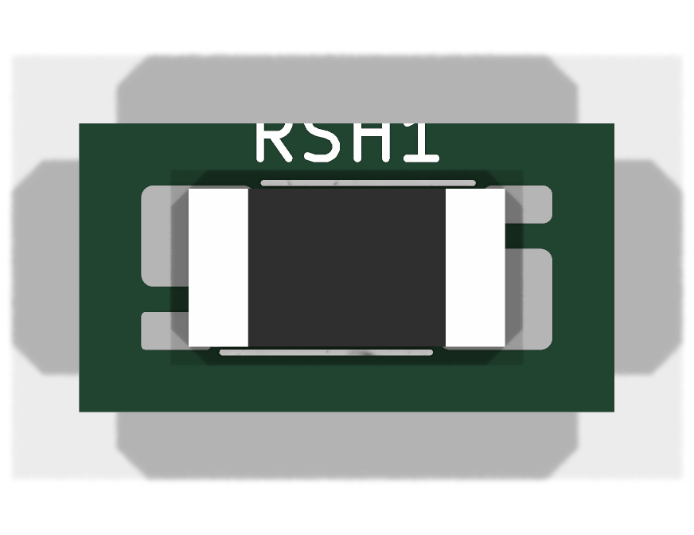

# Parametric 3D bodies: `kct models generate`

About 7,300 stock KiCad footprints point at a STEP file that does not exist
(see [`3d-model-coverage.md`](../research/3d-model-coverage.md)). Most of them
are standard, parametrically describable packages. `kct models generate`
(issue #7687) derives a body for such a footprint from its own fab/courtyard
outline and pad field, plus a few parameters, and writes it as STEP.

## Install

The families are built with [CadQuery](https://github.com/CadQuery/cadquery)
(Apache-2.0). It is an **optional extra**, never a core dependency. The OCP
wheels are large (about 1 GB installed), so it is also left out of `[all]`:

```bash
pip install 'kicad-tools[models]'     # or: uv sync --extra models
```

Without the extra, `kct models generate` prints this install hint and exits 2.
Placeholder mode (`--placeholder`) needs no extra.

## Usage

```bash
kct models families                                  # families + parameters
kct models generate Package_SO:SOIC-8_3.9x4.9mm_P1.27mm           # from the KiCad library
kct models generate Connector_JST:JST_PH_S5B-PH-SM4-TB_1x05-1MP_P2.00mm_Horizontal \
    --pcb boards/03-usb-joystick/output/usb_joystick_routed.kicad_pcb --ref J2
kct models generate board09:SRP7050TA --family box --param H=5.0 \
    --pcb boards/09-usbc-pd-power/output/usbc_pd_power.kicad_pcb --ref L1 --attach
kct models generate chip --param L=3.2,W=1.6,H=0.55  # no footprint: synthesized
```

You can name the footprint in three ways:
- a `Library:Name` lib_id, looked up in the project `fp-lib-table` (next to
  `--pcb`) and then in the KiCad libraries;
- `--footprint FILE.kicad_mod`;
- a footprint as placed on `--pcb` (by `--ref`, or by lib_id). This also
  works for custom libraries.

The default output directory is `~/.cache/kicad-tools/generated-3d` (or
`$KCT_GENERATED_3D_DIR`). Use `-o DIR` to change it. The other output options:
- `--register` records `lib_id -> file` in `DIR/local_models.json`.
- `--attach` writes into `<pcb dir>/3dshapes/`, registers the body, and
  attaches it with `kicad_tools.pcb.models3d.attach_local_models`. This is the
  same project-local tier that board generators call (#7685), so a
  regeneration keeps the body.

## Families

| Family | Packages | Key parameters (mm) |
|---|---|---|
| `chip` | `R/C/L/Fuse/LED_NNNN_NNNNMetric` | `L`, `W`, `H` (size table), `T` |
| `box` | shunts (`R_Shunt_*`), power inductors, any rectangular body | `H` (required unless the name has `AxBxCmm`), `terminals=ends\|pads\|none`, `T` (from `_T<x>mm`) |
| `gullwing` | SOIC/SSOP/TSSOP/MSOP, SOT-23 variants, QFP | `H`, `A1`, `b`, `c` |
| `nolead` | QFN/DFN, with or without EP | `H`, `terminal_h` |
| `header` | 2.00/2.50/2.54 mm pin headers; JST PH/XH-style shrouded, vertical or side-entry | `H`, `orientation`, `shrouded`, `pin` |

Each body is built in the footprint's own frame, using:
- the **fab outline** for the body rectangle. Ears and lead stubs are
  ignored: the longest fab segment on each side wins.
- the **pads** for the leads and terminals.

So the body sits inside the courtyard, with its long axis along the pad field,
and the `(model ...)` node keeps an identity offset and rotation.
`inside_courtyard` in the provenance records the check. The CLI warns when a
parameter override pushes the body past the courtyard.

Top-view renders of the three acceptance targets on the pinned toolchain
(kicad-cli 10.0.6), made by `scripts/boards/render_modelgen_evidence_7687.py`:

| Board 03 J2 (`header`) | Board 09 RSH1 (`box`, `H=0.9`) | Board 09 L1 (`box`, `H=5.0`) |
|---|---|---|
|  |  |  |

## Placeholder mode

`--placeholder` writes a box extruded from the courtyard (`H`, default 1 mm).
It uses a dependency-free STEP writer. The file name ends in `_placeholder`, so
`kct pcb model-audit` and `kct check` classify the footprint as `placeholder`.
That is still a coverage **gap**: a render shows something, but the board does
not count as covered.

## Provenance and licensing

Every body gets a `<stem>.provenance.json` sidecar. It records:
- the generator and its version, and the backend (with the CadQuery version);
- the family, the resolved parameters, and the source footprint with its
  sha256;
- the STEP sha256 and the license.

The same facts are in the STEP header's `FILE_DESCRIPTION`. The header
timestamp is fixed. Placeholder files are byte-reproducible. CadQuery files
always carry the same geometry and colours, but OCCT may write the colour
entities in a different order from run to run.

- **Bodies from these families and placeholders are ours.** They are original
  nominal-envelope geometry derived from the footprint and parameters, and
  ship under this repository's MIT license. No vendor, EasyEDA or
  KiCad-generator geometry is used.
- **KiCad's own generators** (`kicad-library-tools`) are GPL-3.0-or-later.
  kicad-tools never imports or vendors them; `tests/test_modelgen_license_scan.py`
  guards `src/`. To run them anyway, install the tool in its own virtualenv and
  use the bridge. It runs the tool as an external subprocess:

  ```bash
  export KCT_KICAD_LIBRARY_TOOLS_CMD='/opt/klt/venv/bin/python /opt/klt/generator.py --family {target} --params {params_json} --out {out_dir}'
  kct models generate <family> --backend kicad-library-tools --param ...
  ```

  The template is yours. kicad-tools has no knowledge of that tool's flags;
  `{target}`, `{out_dir}` and `{params_json}` are substituted. The provenance
  records the command (and `KCT_KICAD_LIBRARY_TOOLS_VERSION`, when set). It
  also marks the output as CC-BY-SA-4.0-style collection data that needs
  attribution to the KiCad Library Team: decide per case before committing it.
- The `[models]` extra pulls CadQuery and OCP (Apache-2.0). It also pulls their
  runtime dependencies (OpenCASCADE, LGPL-2.1 with an exception), which are
  dynamically linked wheels, not vendored code.
